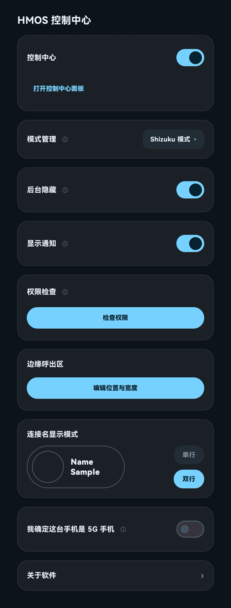
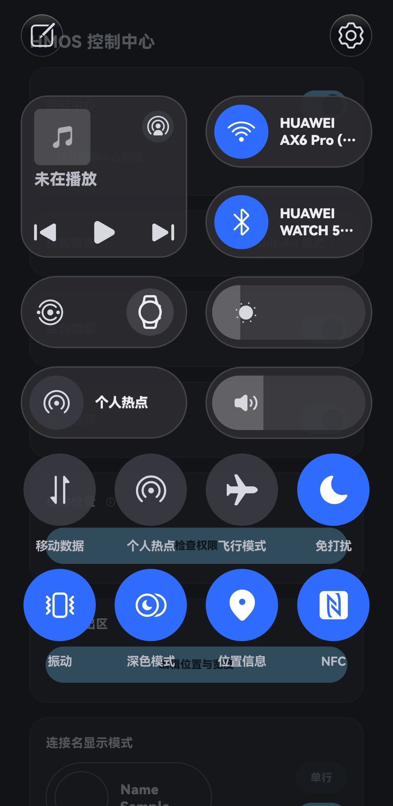

# HMOS 控制中心（HMOSControlCenter）

课余时间写个仿 HarmonyOS 控制中心样式的控制中心，给老华为弄点新鲜玩意

## 目录

- [功能可用性](#功能可用性)
- [快捷开关说明](#快捷开关说明)
  - [5G 开关](#5g-开关)
  - [其他问题](#其他问题)
- [展示图](#展示图)
- [反馈](#反馈)
- [说明](#说明)

## 功能可用性

展开查看

| 功能 | 普通模式 | Shizuku 模式 |
| --- | --- | --- |
| 手电筒 | ✅ | ✅ |
| 铃声状态 | ✅ | ✅ |
| 旋转锁定 | ✅ | ✅ |
| 免打扰 | ✅ | ✅ |
| 护眼 | ✅ | ✅ |
| 深色模式 | ❌ | ✅ |
| 省电模式 | ❌ | ✅ |
| NFC | ❌ | ✅ |
| 移动数据 | ❌ | ✅ |
| 飞行模式 | ❌ | ✅ |
| 位置信息 | ❌ | ✅ |
| 个人热点 | ❌ | ✅ |
| 5G | ❌ | ✅ |
| 悬浮导航 | ❌ | ✅ |
| 无线反向充电 | ❌ | ✅ |
| 中转站 | ❌ | ✅ |
| 无线传声 | ❌ | ✅ |
| 快捷提醒 | ❌ | ✅ |
| 扫一扫 | ✅ | ✅ |
| 相机 | ✅ | ✅ |
| 计算器 | ✅ | ✅ |
| 计时器 | ✅ | ✅ |
| 云空间 | ✅ | ✅ |
| 录音机 | ✅ | ✅ |
| 智能遥控 | ✅ | ✅ |
| 屏幕录制 | ✅ | ✅ |
| 截屏 | ❌ | ✅ |
| 无线投屏 | ✅ | ✅ |
| 小艺翻译 | ❌ | ✅ |
| AI 字幕 | ❌ | ✅ |
| 驾驶场景 | ❌ | ✅ |
| FIDO 安全密钥 | ❌ | ✅ |
| 亮度滑轨 | ✅ | ✅ |
| 自动亮度 | ✅ | ✅ |
| 音量滑轨 | ✅ | ✅ |
| 媒体播放（上一首/播放暂停/下一首） | ✅ | ✅ |
| WLAN 开关 | ❌ | ✅ |
| 蓝牙开关 | ✅ | ✅ |

## 快捷开关说明

- 面板默认摆 8 颗（移动数据、个人热点、飞行模式、免打扰、响铃、深色模式、位置信息、NFC），其余在编辑页里
- **个人热点在 `普通模式` 下读不到状态**，胶囊会一直显示「关」。这是如实反映（系统不告诉我们），不是开关坏了。使用 Shizuku 后能读能开。开热点时系统会自动关掉 Wi-Fi，这是手机自身的行为（华为的 `WLAN 桥` 跟 `个人热点` 整合起来了，但我们无权调用）
- **蓝牙开关在 `普通模式` 下**系统会弹一个「软件请求开启/关闭蓝牙」的确认框；它的层级比面板低，会被面板盖住，看着像没反应。把面板收起来就能看到那个框。Shizuku 模式下不再弹框

### 5G 开关

- 面板上**有没有**这颗开关，取决于软件能否确认这台手机支持 5G。如果没识别出来但你的手机确实是 5G 机型时，可以在设置页里手动打开
- **需要 Shizuku 模式才能打开**

### 其他问题

1. **免打扰开着时切到静音**，华为会闪一句系统提示条。这句提示关不掉（系统对「免打扰 + 静音」这个组合本身不乐意），但铃声确实已经改好了。
2. **华为分享没有**，它的入口被华为的签名权限挡着

## 展示图

设置页面

控制中心页面

## 反馈

遇到问题或有建议，欢迎通过 [Issues](https://github.com/GSpaceKS/HMOSControlCenter/issues) 反馈。为了便于排查，请尽量附上以下信息：

- 手机型号（如 Mate 40 Pro+）
- 系统版本（如 HarmonyOS 4.2.0）
- 使用的模式（普通模式 / Shizuku 模式）
- 问题描述与复现步骤
- 相关截图或录屏（如有）

> 请先搜索是否已有相同 Issue，避免重复提交。

## 说明

**本项目非华为官方产品，与华为无关联**

> 当前为个人自用项目，暂未开源，保留所有权利；后续可能开源